<div align="center">



# The Movie Calendar

**A monthly calendar to log the films you watch, with the posters front and center.**

Search TMDB, drag to reorder, pick each day's cover, and export your month as a JPG ready for social media.


</div>

---

## Table of contents

1. [What is it?](#what-is-it)
2. [Features](#features)
3. [How to use it](#how-to-use-it)
4. [Tech stack](#tech-stack)
5. [Requirements](#requirements)
6. [Installation and local setup](#installation-and-local-setup)
7. [Deploying to Netlify](#deploying-to-netlify)
8. [Project structure](#project-structure)
9. [How it works under the hood](#how-it-works-under-the-hood)
10. [JPG export](#jpg-export)
11. [Persistence and privacy](#persistence-and-privacy)
12. [Troubleshooting](#troubleshooting)
13. [Credits](#credits)

---

## What is it?

Movie Diary is a personal web app that works as a **diary of watched films, organized in a monthly calendar**. Each day can hold every film you watched that day, but the calendar shows only one poster per day (the one you choose as the cover), so opening the app gives you a mosaic of your month in posters.

It needs no user accounts and no backend: everything is stored in your own browser, and film data (titles, synopses, posters, ratings) comes from the official [The Movie Database (TMDB)](https://www.themoviedb.org/) API.

The look draws on film diaries and editorial apps: dark background, large type, and posters as the main visual element.

## Features

### Monthly calendar
- The app opens on the **current month and year**, with today highlighted by a colored border.
- The week **starts on Monday**.
- Days from the previous and next months needed to complete the weeks are shown dimmed.
- **Unlimited navigation** through past and future months, with previous month, next month, and "Today" buttons.
- Each day shows its number over the cover poster. Empty days appear as a subtle placeholder tile.
- When a day has more than one film, a **counter (`×2`, `×3`...)** appears in the corner of the poster.
- The app remembers the last month you were viewing.

### Searching and adding films
- An **Add** button opens a search window connected to TMDB's `/search/movie` endpoint.
- **400 ms debounce**: no request per keystroke, and previous requests are cancelled when you keep typing.
- Results show the poster, title, release year, and the original title when it differs.
- A date picker inside the search window lets you log a film on the day you actually watched it.
- Clear states for loading, no results, and connection errors.
- **No duplicates** on the same day: if a film is already added, it is marked "Added" and cannot be repeated.
- You can add several films in a row without closing the window.
- If a film has no poster, an alternative design with its title is shown.

### Day view
Clicking a day opens a side panel (on mobile, a sheet sliding up from the bottom) with:
- The **full date**.
- All films for that day, with poster, title, year, and **position**.
- **Drag & drop** reordering, with mouse, touch, and keyboard. The order is saved.
- A **star** to choose which film is the day's cover. This is independent of order: you can watch three films and make the third one the cover.
- If you delete the film that was the cover, the app automatically picks another one.

### Film details
Clicking a film within a day opens its detail view with a large poster, title, original title, year, synopsis, and TMDB rating (if available). From there you can set it as the cover or remove it from that day **without affecting the others**.

### JPG export
- Two formats: **landscape 16:9 (1920 × 1080)** and **portrait 9:16 (1080 × 1920)**.
- The image is built from a dedicated layout for each format, not a screenshot.
- It includes the month name, the year, the number of films that month, the full calendar, cover posters, and multi-film indicators.
- It downloads directly, with a name like `calendario-cinematografico-noviembre-2026.jpg`.

### Responsive design
Works on desktop, laptop, tablet, and mobile. On small screens the grid tightens, buttons show only icons, and panels adapt to the width, with no horizontal scrolling.

## How to use it

1. **Add a film.** Click **Add**, type the title, choose the day, and click the right result.
2. **Look at your calendar.** The day fills with the poster. Add a second film and you'll see the `×2` counter.
3. **Open a day.** Click it to see all the films for that date.
4. **Reorder.** Drag a film by the six-dot handle on its left.
5. **Pick the cover.** Click the star on the film you want to see on the calendar.
6. **See details.** Click a film to read its synopsis and rating, or to remove it.
7. **Export the month.** Click **Export** and choose landscape or portrait.

## Tech stack

| Area | Technology |
| --- | --- |
| UI | [React 18](https://react.dev/) |
| Build tool | [Vite](https://vitejs.dev/) |
| Drag & drop | [dnd-kit](https://dndkit.com/) (`core`, `sortable`, `utilities`) |
| Icons | [Lucide](https://lucide.dev/) |
| Typography | [Bricolage Grotesque](https://fonts.google.com/specimen/Bricolage+Grotesque), bundled via `@fontsource-variable` (no runtime dependency on Google Fonts) |
| Film data | [TMDB API](https://developer.themoviedb.org/docs) |
| Export | Native browser Canvas 2D |
| Persistence | `localStorage` |
| Hosting | [Netlify](https://www.netlify.com/) |

## Requirements

- **Node.js** (LTS recommended) and **npm**, which ships with Node.
- A modern browser (Chrome, Edge, Firefox, Safari).

## Installation and local setup

```bash
# 1. Clone the repository
git clone https://github.com/DavidFerreiro-dev/<repository-name>.git
cd <repository-name>

# 2. Install dependencies
npm install

# 3. Start the development server
npm run dev
```

Open the address printed in the terminal (usually `http://localhost:5173`).

Other commands:

| Command | What it does |
| --- | --- |
| `npm run dev` | Development server with hot reload |
| `npm run build` | Builds the production version into `dist/` |
| `npm run preview` | Serves the production build locally for checking |

> **Windows / PowerShell:** if `npm` fails with "running scripts is disabled", run `Set-ExecutionPolicy -Scope CurrentUser RemoteSigned` once, or use `npm.cmd` instead of `npm`.

## Deploying to Netlify

1. Push the project to a GitHub repository.
2. In Netlify, choose **Add new site → Import an existing project** and connect the repository.
3. Netlify reads its settings from `netlify.toml`:
   - Build command: `npm run build`
   - Publish directory: `dist`
4. Trigger the deploy.

`netlify.toml` also includes a `/* → /index.html` redirect, in case internal routes are added later.

## Project structure

```
.
├── index.html                 # HTML entry point
├── netlify.toml               # Build settings and redirects
├── vite.config.js
├── package.json
├── .gitignore
└── src/
    ├── main.jsx               # React bootstrap and font loading
    ├── App.jsx                # View state: month, open panels
    ├── styles.css             # All styling (CSS variables, responsive)
    ├── media/
    │   └── logo.png           # Project logo (used in this README)
    ├── lib/
    │   ├── tmdb.js            # TMDB API client and image helpers
    │   ├── store.js           # Day state, persistence, and date helpers
    │   └── exportImage.js     # JPG generation with canvas
    └── components/
        ├── Calendar.jsx       # Monthly grid
        ├── Poster.jsx         # Poster with fallback design when no image exists
        ├── SearchModal.jsx    # Debounced TMDB search
        ├── DayPanel.jsx       # Day view, drag & drop, and film details
        └── ExportModal.jsx    # Export format picker
```

## How it works under the hood

### Data model

The whole diary is a single object, keyed by date in `YYYY-MM-DD` format:

```js
{
  view: { y: 2026, m: 10 },           // last viewed month (m: 0 = January)
  days: {
    "2026-11-01": {
      cover: 157336,                  // TMDB ID of the cover film
      movies: [                       // array order IS the day's order
        {
          id: 157336,
          title: "Interstellar",
          original_title: "Interstellar",
          year: "2014",
          overview: "...",
          poster: "/gEU2QniE6E77NI6lCU6MxlNBvIx.jpg",
          rating: 8.5
        }
      ]
    }
  }
}
```

The cover is stored by **film ID**, not by position. That's why reordering never changes which poster appears on the calendar.

### State management

`store.js` uses a `useReducer` with four actions (`add`, `remove`, `reorder`, `cover`) plus one to remember the viewed month. A `useEffect` writes the full state to `localStorage` every time it changes. The key rules live in the reducer:

- `add` ignores a film that already exists on that day, and makes it the cover if it's the first of the day.
- `remove` deletes the whole day when it becomes empty and reassigns the cover if the cover film is removed.

### Calendar

`buildWeeks()` computes the month's weeks starting on Monday (`(getDay() + 6) % 7`) and pads the gaps. Dates for days outside the month are resolved through `Date` overflow, and all calculations use local dates to avoid timezone drift.

### Search

`SearchModal` waits 400 ms after the last keystroke, sends the request with an `AbortController`, and cancels the previous one if a new one starts. Requests use `language=es-ES` and `include_adult=false`, and are authenticated with a Bearer header. Errors are split into service failure and no connection.

### Drag & drop

`DayPanel` uses `@dnd-kit/sortable`. Dragging starts **only from the grip handle** (with `touch-action: none` on that element), so on mobile you can still scroll the list normally. Keyboard reordering works too. On drop, the reducer receives the new ordered array and it is saved.

## JPG export

`exportImage.js` draws the calendar directly onto a `<canvas>` at its final size (1920 × 1080 or 1080 × 1920):

1. It loads the font and downloads the cover posters at `w500` quality (TMDB images allow cross-origin access, which is required to export a canvas).
2. It computes the grid from the number of weeks in the month and the chosen format.
3. It draws each poster cropped with `object-fit: cover` logic, a gradient at the top so the day number stays readable, and the `×N` badge on days with several films.
4. It converts the canvas to JPG (0.93 quality) and downloads it without opening new tabs.

If a poster can't be downloaded, that day is drawn as an empty tile instead of breaking the export.

## Persistence and privacy

- Data is saved in your browser's `localStorage` under the key `cine-diario:v1`.
- **Nothing is sent to any server of mine**: the only external communication is searches to TMDB and poster downloads.
- Each browser and each device has its own independent diary. Switching browsers, using incognito mode, or clearing site data leaves it empty.
- To avoid losing your diary, don't clear the site's data. Data export and backup is a planned improvement (see below).

## Troubleshooting

| Problem | Likely cause and fix |
| --- | --- |
| "No connection to TMDB" | No internet, or a network/blocker preventing access to `api.themoviedb.org`. |
| Posters missing in the export | Posters couldn't be downloaded (connection or blocker). They export as empty tiles; retry with a stable connection. |
| `npm` not recognized on Windows | Node.js isn't installed, or the terminal needs a restart after installing it. |
| `npm` blocked by script policy | Run `Set-ExecutionPolicy -Scope CurrentUser RemoteSigned` or use `npm.cmd`. |
| Very slow install inside OneDrive | OneDrive syncs `node_modules`. Move the project outside OneDrive. |

> The app's interface and its error messages are in English.

## Future ideas

- Export and import diary data as a backup file.
- Personal notes and ratings per film.
- Monthly and yearly stats.

## Credits

**Development:** [David Ferreiro](https://github.com/DavidFerreiro-dev) — [@DavidFerreiro-dev](https://github.com/DavidFerreiro-dev)

**Film data and images:**

<a href="https://www.themoviedb.org/">
  
</a>

This product uses the TMDB API but is not endorsed or certified by TMDB.

Posters, titles, synopses, and ratings belong to their respective owners and are provided through [The Movie Database](https://www.themoviedb.org/).

**Open-source libraries:** React, Vite, dnd-kit, Lucide, and Fontsource, each under its own license.

---

<div align="center">

Made with love for cinema by [David Ferreiro](https://github.com/DavidFerreiro-dev)

</div>
